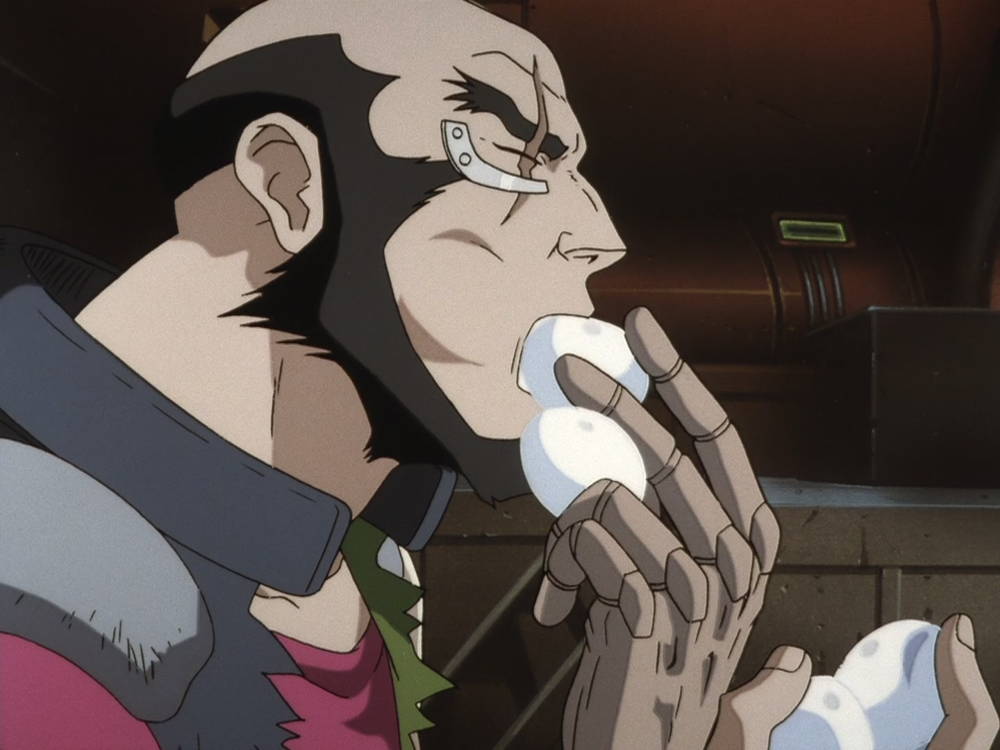
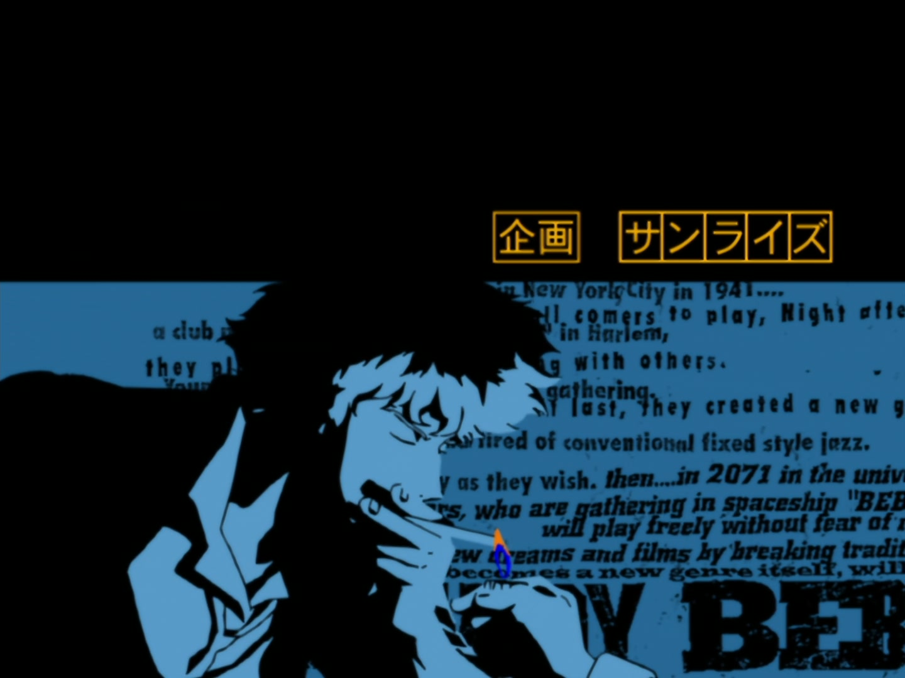

人は悲しいとき、何をするか

ゆで卵を食べる

エドワード・ウォン・ハウ・ペペル・チブルスキー4世。天才ハッカーで、13歳のガキんちょ。たぶん『カウボーイビバップ』でいちばん忘れられがちなキャラクターだ。ああ、もちろん、船にいたあの犬の名前なんて誰も覚えていない。

『カウボーイビバップ』は、アニメ通を気取る人たちがいちばん好んで語りたがる作品のひとつだ。今敏、エヴァ、銀河英雄伝説と並んで、いつまでも色あせない。

いろんな評を読んだけれど、どれもスパイクの過去の話をしている。片方の目で今を見て、もう片方の目は過去に置いてきた。ジェットの手元に残った懐中時計、帰れないガニメデ、そして凍結されたまま戻れない、フェイの時間。

過去に生きる人、過去を手放す人、過去を探す人。

エドは違う。若くて、屈託がないからだ。なにしろ宇宙時代なのだ。孤児院に放り込まれても誰も気にかけないし、やっと見つけた実の父親でさえ、彼女の性別なんて気にしていない。

しかも天才児で、ゴーグルを頭にのせている。フェイが彼女を置き去りにして船を出したときには、ビバップ号を遠隔操作で呼び戻し、この賞金稼ぎの船に乗り込んでしまった。これで、スパイクの言う嫌いなもの三つ、「ガキと、けだもんと、はねっ返りの女」が全部そろった。

天才ハッカーは、どうやって父親を見つけるのか。もちろん、最高の賞金稼ぎを使えばいい。自分の父親に5000万の賞金をかけて、ジェットとスパイクに見つけさせたのだ。ところが結局、賞金額を読み間違えていて、手に入ったのはたったの50ウーロン。ジェットとスパイクは、夢にまで見た肉入りのすき焼きを、やっぱり買えなかった。

残念なような、残念じゃないような話だけれど、彼女は父親を見つけたのに、父親はまた去っていった。それでエドは船に戻らず、作中でいちばん頭のいい犬も、エドと一緒に行ってしまった。

エドが去る回のラストは「SEE YOU SPACE COWGIRL, SOMEDAY, SOMEWHERE!」だった。「See you, Cowboy」で終わらないのは二話だけで、もう一話は最終回、スパイクの「バン」のあとに幕を下ろす「YOU'RE GONNA CARRY THAT WEIGHT.」だ。

フェイもその回で、シンガポールに残った。

船にはジェットとスパイクだけが残った。最初と同じだ。でも今回は、ようやく、肉のないチンジャオロースではなかった。食べられるのは、本当は船のみんなで食べるはずだったゆで卵だけだ。

スパイクとジェットはテーブルにつき、目の前にはゆで卵の山。二人はほとんど口もきかず、一つ、また一つと、大口で頬張っていく。

実のところ、エドは行かなければならなかったし、あれがもう、いちばんいい去り方だった。この後の展開はみんな知っている。少なくとも悲しいときは、ゆで卵を多めに食べられる。肉のないチンジャオロースよりはいい。

『カウボーイビバップ』は1998年から来たロマンだ、とみんな好んで言う。そのとおり。ジャズ、煙草、銃、賞金稼ぎ、粋で孤独な男たち。

「仕事、見つかったのかい？」

「心配ないよ」

「好きな女の子は？」

「結婚するってさ」
