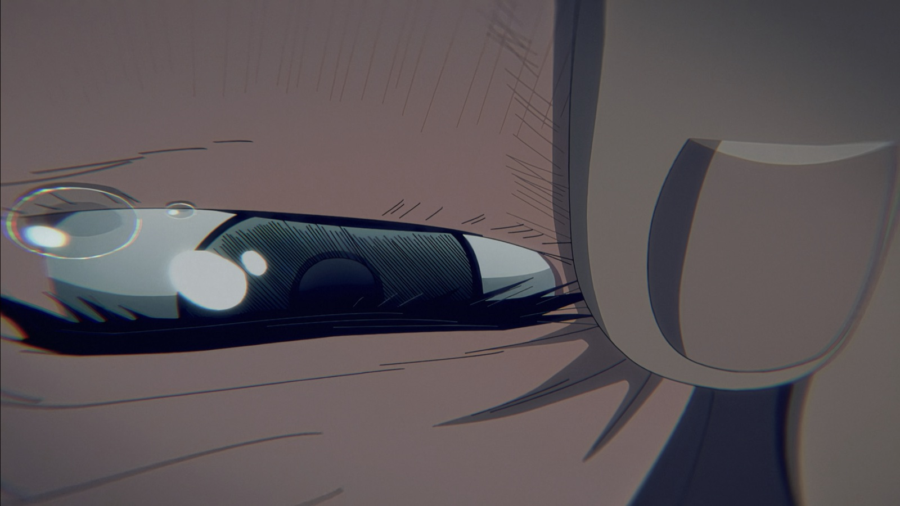

这部番剧，口音就很奇怪

我不是日语的母语者，但是还是能听得出来是关西腔，这个真的是日语学习之后带来的一个非常额外的好处，你可以去理解和感受一些很细微的差异，如果是带着中文字幕看的话，你一辈子也听不出来

总之剧里的人说话都比较土土的，但是又意外的比较亲切好听

如果文艺作品看的比较多的话，其实这个剧的主题根本不复杂，就是

偽物

我觉得这个词，无法翻译成中文，但，中文母语者都能看懂

至于什么沼泽人呀，忒修斯之船呀，都不重要，这部剧就不是讲这个的

前期有点那种民俗恐怖的味道在里面，特别是夏天，永远不停的蝉鸣

一部很好的番剧，各个地方都没什么可挑剔的地方

但如果就那么平平淡淡的话，我也不会写这篇

死掉的光和现在的光，就是两个人

十二集的那里，朝子知道了这一切

知道了又能怎么样，知晓一个悲伤的事情不会让你变的开心

光就是死了，哪怕有一个长的一模一样的人，继承了之前的记忆的偽物

所以朝子开始哭泣，为死去的光而哭泣，那一幕特别感人，继承了光的身份的偽物为朝子拭去右眼外眼角的泪

你可以假装什么都不知道

但左眼的泪却止不住

